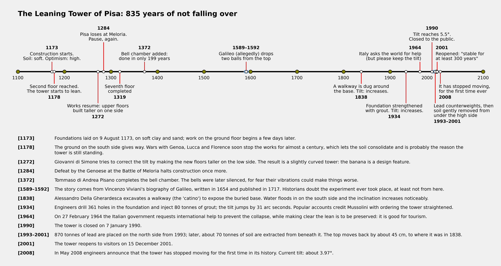

[](https://doi.org/10.5281/zenodo.23961870)

# timeline

Annotated timeline charts from a JSON file: a time axis, one label per event,
and an optional list of notes underneath. Publication-ready PNG, PDF or SVG.



The layout is automatic and is checked after drawing. Labels never overlap,
connectors never run through text, the figure height adapts to the content,
and the spacing between notes is uniform. You only write the data.

## Requirements

Python ≥ 3.9 and matplotlib ≥ 3.5:

```bash
pip install -r requirements.txt
```

## Quick start

```bash
python timeline.py examples/leaning_tower_of_pisa.json   # → examples/leaning_tower_of_pisa.png
python timeline.py examples/*.json                       # all examples at once
python timeline.py mydata.json -o figure.pdf             # choose name and format
python timeline.py mydata.json --show                    # also open a window
```

Each run prints the output file, the figure size and the result of the layout
check, e.g. `layout check: OK`.

## Folder layout

```
timeline.py          the tool (single file)
examples/            example data, each with its rendered PNG
  hooke_young_en.json        From Hooke's law to Young's modulus (English)
  hooke_young_it.json        Dalla legge di Hooke al modulo di Young (italiano)
  euler_bernoulli_en.json    The Euler-Bernoulli beam (English)
  euler_bernoulli_it.json    La trave di Eulero-Bernoulli (italiano)
  leaning_tower_of_pisa.json showcase: dense clusters, ranges, long notes
```

## Data format

```json
{
  "config": {
    "title": "From Hooke's law to Young's modulus",
    "chart_width": 13.0
  },
  "events": [
    {
      "date": "1676",
      "label": "Hooke publishes\nthe law as\nan anagram",
      "note": "The anagram \"ceiiinosssttuu\" served to establish priority..."
    },
    { "date": "1490-1499", "label": "Leonardo's drawings\nin the Codex Madrid I" }
  ]
}
```

### Events

| key     | required | meaning |
|---------|----------|---------|
| `date`  | yes | A year (`"1660"`, `"-500"` for 500 BC) or a range (`"1490-1499"`). A range is drawn as a band on the axis, with the connector at its midpoint. |
| `label` | yes | Text next to the axis. Use `\n` for line breaks. |
| `note`  | no  | Longer text listed under the chart as `[date] note`. It is wrapped automatically. |
| `side`  | no  | Force the label `"above"` / `"below"` the axis (or `"right"` / `"left"` when vertical). |

Events are sorted by date. Events with exactly the same date are merged into
one block, with one date and one connector. Matplotlib mathtext works in labels
and notes (`"$\\sigma = E\\varepsilon$"`).

### Configuration

Every key is optional. Lengths are in inches, font sizes in points.

| key | default | meaning |
|-----|---------|---------|
| `title` | `""` | Chart title. |
| `output_file` | JSON name + `.png` | Output path, relative to the JSON file. The extension sets the format. |
| `dpi` | `300` | Resolution of raster output. |
| `orientation` | `"horizontal"` | `"horizontal"` or `"vertical"` (time runs downward). |
| `chart_width` | `13.0` | Figure width. In vertical charts this is a minimum: the figure widens if needed. |
| `chart_height` | `9.0` | Vertical charts only: length of the time axis. Horizontal charts compute their height. |
| `axis_clearance` | `0.30` | Minimum distance between the axis and the nearest label. |
| `label_padding` | `0.12` | Minimum free space around every label. |
| `date_gap` | `0.05` | Space between a label and its date. |
| `notes_gap` | `0.35` | Space between the chart and the notes. |
| `tick_step` | `"auto"` | Years between axis ticks, or `"auto"`. |
| `tick_label_offset` | `0.12` | Distance between the axis and the tick labels. |
| `font_family` | `"DejaVu Sans"` | Any font installed on the system. |
| `font_title`, `font_ticks`, `font_dates`, `font_events`, `font_notes` | `14, 9, 9, 9, 9` | Font sizes. |
| `event_linespacing`, `note_linespacing` | `1.15, 1.35` | Line spacing of labels and notes. |
| `label_wrap_chars` | `null` | If set, labels are also wrapped automatically at this many characters. |
| `show_notes` | `true` | Draw the notes under the chart. |
| `note_spacing` | `0.8` | Empty space between two notes, as a fraction of a note line. |
| `background_color` | `"#f0f0f0"` | Use `"white"` for papers. |
| `text_color`, `axis_color`, `tick_color`, `marker_color`, `connector_color`, `range_color` | | Colours (any matplotlib colour). |
| `border_color` | `null` | If set, draws a frame around the chart and around the notes. |

Unknown keys produce a warning, so typos don't go unnoticed. Keys from version 1
(`font_centuries`, `note_paragraph_gap`, `century_tick_distance`) are still
accepted. The old layout tuning keys (`min_axis_distance`, `label_distance`,
`close_year_threshold`, ...) are ignored because the layout is now automatic.

## How the layout works

1. Every label and date is measured as it will be rendered, in inches.
2. An optimiser chooses, for each event, the side of the axis and how the label
   sits on its connector: centred, or as a flag to the left or right. It then
   stacks the labels so that no texts overlap and no connector passes through
   another label, keeping the chart as compact as possible.
3. Events too close in time to be separated this way get a connector with a
   single bend in the empty band next to the axis. In horizontal charts, labels
   still in conflict are then re-wrapped to narrower lines.
4. A tick label in the way of a connector is nudged sideways, or omitted if
   there is no room.
5. The finished drawing is checked for overlapping text and for connectors
   crossing text. If something could not be resolved (a very extreme case),
   the connector is drawn faded behind the text and a warning tells you which
   events are involved. You can shorten those labels, widen the chart, or set
   `side`.

## Tips

- Short labels (2–3 lines of 20–35 characters) give the cleanest charts. Put
  the details in `note`.
- For slides, increase the font sizes and reduce `chart_width`. The layout
  adapts.
- For LaTeX documents, use `-o figure.pdf` so the text stays vector.

## History and credits

Author: Angelo Simone (University of Padua).

- **v0** (before April 2026): one script per timeline, with the data in the
  code. Started from the CoderzColumn tutorial
  [Timeline using Matplotlib](https://coderzcolumn.com/tutorials/data-science/timeline-using-matplotlib).
- **v1** (April 2026): data and settings in JSON, notes box, collision-aware
  stacking. Developed with the help of ChatGPT (OpenAI) and Gemini (Google).
- **v2.0** (4 November 2026): layout engine rewritten with Claude (Anthropic).
  Optimised label placement with no overlaps (bent connectors when needed),
  automatic figure height and ticks, date ranges, merged same-date events,
  vertical orientation, uniform note spacing, layout self-check, and a
  command-line interface. Examples in English and Italian, plus the Leaning
  Tower showcase.

Sources for the Leaning Tower example: Wikipedia, *Leaning Tower of Pisa*;
PBS NOVA, *Interventions* (pbs.org/wgbh/nova/pisa).

## License

[MIT](LICENSE) © 2026 Angelo Simone
